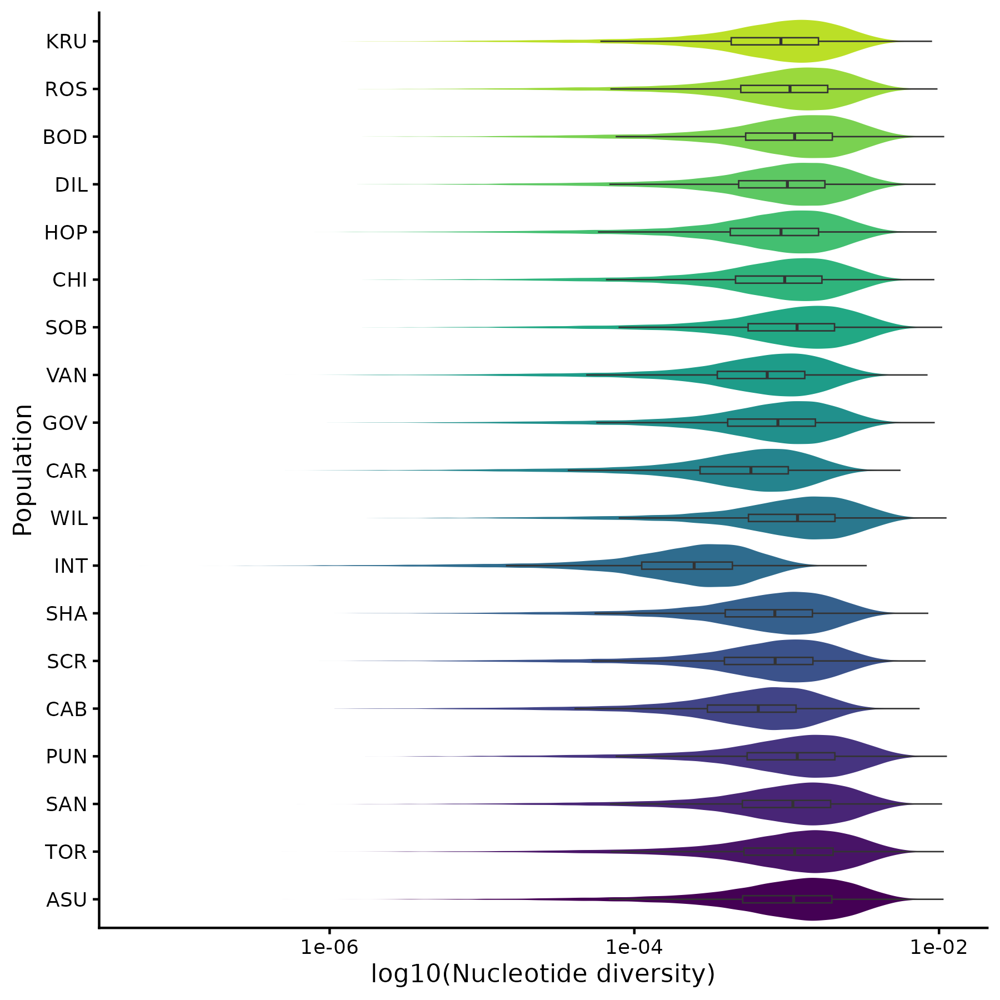
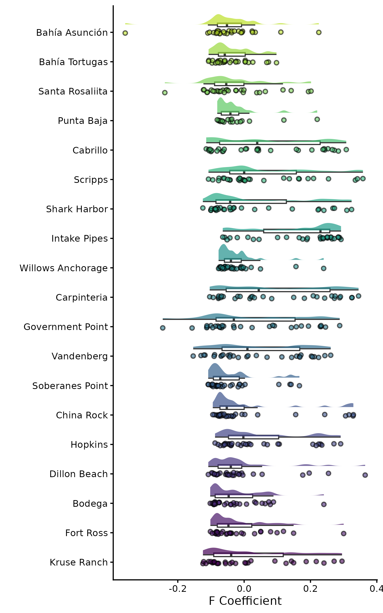
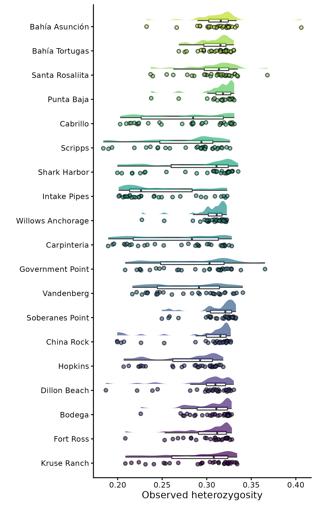
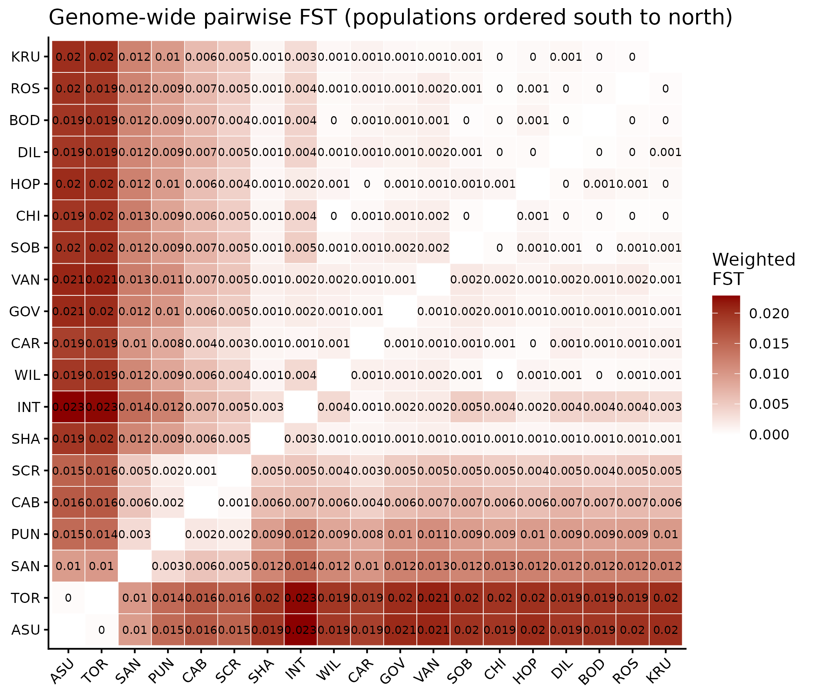

# Population Genomics Notebook

**Course:** Intro to Ecological Genomics - Fall 2026

**Name:** Walt Regan-Loomis

------------------------------------------------------------------------

## \*\* - Template

-   

**Working Directory**

`/gpfs1/home/w/r/wreganlo/eco_genomics_2026/population_genomics`

**Input Files:**

`none`

**Output Files:**

`/gpfs1/home/w/r/wreganlo/eco_genomics_2026/transcriptomics/population_genomics_notebook.md`

`/gpfs1/home/w/r/wreganlo/eco_genomics_2026/transcriptomics/myscripts/10.22.2026.genetic.diversity`

**Programs and dependencies:**

-   `R version 4.5.1`

-   `R-Studio`

**Scripts:**

`none`

**Code:**

``` r
```

**Table:**

| Col1 | Col2 | Col3 |
|------|------|------|
|      |      |      |
|      |      |      |
|      |      |      |

**Image:**

**Notes / Observations:**

-   

**Next Steps:**

------------------------------------------------------------------------

## 10.20.2026 - VCF Messing Around

-   Setting up and copying files into my data

-   using plink to run analysis

**Working Directory**

`/gpfs1/home/w/r/wreganlo/eco_genomics_2026/population_genomics`

**Input Files:**

`~/projects/eco_genomics_2026/popoulation_genetics/mydata/Lg_LD_0.2eigenval`

`~/projects/eco_genomics_2026/popoulation_genetics/mydata/Lg_LD_0.2eigenvec`

**Output Files:**

`/gpfs1/home/w/r/wreganlo/eco_genomics_2026/population_genetics/population_genomics_notebook.md`

`/gpfs1/home/w/r/wreganlo/eco_genomics_2026/population_genetics/myscripts/10.20.2026_VCF_PCA.R`

`/gpfs1/home/w/r/wreganlo/eco_genomics_2026/population_genetics/myscripts/10.20.2026_VCF_admixture.R`

**Programs and dependencies:**

-   `R version 4.5.1`

-   `R-Studio`

-   `PLINK v1.9.0-b.7.7 64-bit (22 Oct 2024)`

**Scripts:**

`DATA_CIR=/users/w/r/wreganlo/projects/eco_genomics_2026/popoulation_genetics/mydata/`

`VCF=$DATA_DIR/Lottia_gigantea_flt3_sub0.01.vcf.gz`

**Code:**

``` r
##We should start organising our results file a bit, lets make a sub directory called PopulationStructure
mkdir -p ~/path/to/my/directory/PopulationGenomics/myresults/PopulationStructure 

# where the VCF lives (make sure this is the right path!)
DATA_DIR=/path/to/my/directory/PopulationGenomics/mydata
VCF=$DATA_DIR/Lottia_gigantea_pl_flt3.renamed.vcf.gz

# check the variable holds what you expect, and that the file is really there
echo $VCF
ls -lh $VCF

cd $DATA_DIR
pwd ##check you are in the right place

##We should start organising our results file a bit, lets make a sub directory called PopulationStructure
mkdir -p ~/path/to/my/directory/PopulationGenomics/myresults/PopulationStructure 

# where the VCF lives (make sure this is the right path!)
DATA_DIR=/path/to/my/directory/PopulationGenomics/mydata
VCF=$DATA_DIR/Lottia_gigantea_pl_flt3.renamed.vcf.gz

# check the variable holds what you expect, and that the file is really there
echo $VCF
ls -lh $VCF

cd $DATA_DIR
pwd ##check you are in the right place

##We should start organising our results file a bit, lets make a sub directory called PopulationStructure
mkdir -p ~/path/to/my/directory/PopulationGenomics/myresults/PopulationStructure 

# where the VCF lives (make sure this is the right path!)
DATA_DIR=/path/to/my/directory/PopulationGenomics/mydata
VCF=$DATA_DIR/Lottia_gigantea_pl_flt3.renamed.vcf.gz

# check the variable holds what you expect, and that the file is really there
echo $VCF
ls -lh $VCF

cd $DATA_DIR
pwd ##check you are in the right place
```

**Code for Admixture:**

``` bash
# keep a copy of the original .bim file (only run this line once! see below)
cp Lg_LD_0.2.bim Lg_LD_0.2.bim.orig

# read the original, replace column 1 (the chromosome) with 0, and write the new .bim
# OFS="\t" keeps the columns tab-separated
awk 'BEGIN{OFS="\t"} {$1="0"; print}' Lg_LD_0.2.bim.orig > Lg_LD_0.2.bim

# compare before and after
head -n 3 Lg_LD_0.2.bim.orig
head -n 3 Lg_LD_0.2.bim

# keep a copy of the original .bim file (only run this line once! see below)
cp Lg_LD_0.2.bim Lg_LD_0.2.bim.orig

# read the original, replace column 1 (the chromosome) with 0, and write the new .bim
# OFS="\t" keeps the columns tab-separated
awk 'BEGIN{OFS="\t"} {$1="0"; print}' Lg_LD_0.2.bim.orig > Lg_LD_0.2.bim

# compare before and after
head -n 3 Lg_LD_0.2.bim.orig
head -n 3 Lg_LD_0.2.bim

##Running as Bash Job:

#!/bin/bash
#SBATCH --job-name=admixture
#SBATCH --partition=general
#SBATCH --nodes=1
#SBATCH --cpus-per-task=8
#SBATCH --mem=16G
#SBATCH --time=24:00:00
#SBATCH --output=./logs/%x.%j.out
#SBATCH --error=./logs/%x.%j.err
#SBATCH --mail-type=END
#SBATCH --mail-user=NETID@uvm.edu

cd ~/popgen/class2
module load admixture

INPUT="Lg_LD_0.2.bed"
THREADS=${SLURM_CPUS_PER_TASK}   # use as many threads as CPUs we asked for

rm -f cv_errors.tsv
for K in $(seq 1 10); do
    admixture --cv -j${THREADS} "${INPUT}" ${K} | tee "admixture_K${K}.out"
    CV=$(grep "CV error" "admixture_K${K}.out" | awk '{print $NF}')
    echo -e "${K}\t${CV}" >> cv_errors.tsv
done
```

**Image:**


**Notes / Observations:**

-   

**Next Steps:**

-   More in class learning

------------------------------------------------------------------------

## 10.22.2026 - Genetic Diversity

-   Working more with the data and finding genetic diversity metrics (nucleotide diversity (π), Tajima’s D and heterozygosity measure)

-   Made Pi folder in myresults

**Working Directory**

`/gpfs1/home/w/r/wreganlo/eco_genomics_2026/population_genomics`

**Input Files:**

`~/projects/eco_genomics_2026/popoulation_genetics/mydata/pi/BOD.windowed.pi`

`~/projects/eco_genomics_2026/popoulation_genetics/mydata/pi/PGR.windowed.pi`

**Output Files:**

`/gpfs1/home/w/r/wreganlo/eco_genomics_2026/population_genetics/population_genomics_notebook.md`

**Programs and dependencies:**

-   `R version 4.5.1`

-   `R-Studio`

-   `VCF Tools 0.1.16`

**Scripts:**

`DATA_CIR=/users/w/r/wreganlo/projects/eco_genomics_2026/popoulation_genetics/mydata/`

`VCF=$DATA_DIR/Lottia_gigantea_flt3_sub0.01.vcf.gz`

**Code:**

``` bash
cd ~/path/to/my/files/PopulationGenomics/mydata

module load vcftools
vcftools --version   # note the version in your notebook

# the 1% subset from Class 1 (make sure this is the right path!)
# We will assign our data directory and VCF now so we dont have to move around to find this. We will now call #$VCF when needed
DATA_DIR=~</path/to/my/files>/PopulationGenomics/mydata ###remember change whats in the <>
VCF=$DATA_DIR/Lottia_gigantea_pl_flt3_noMAF_sub0.01.vcf.gz

# check which columns hold the sample ID and the site
head sample_metadata.csv

# skip the header line (tail -n +2), keep columns 1 and 2 (cut),
# and swap the comma between them for a tab (tr)
tail -n +2 sample_metadata.csv | cut -d ',' -f 1,2 | tr ',' '\t' > popmap.txt
head popmap.txt ##check it looks correct

# check which columns hold the sample ID and the site
head sample_metadata.csv

# skip the header line (tail -n +2), keep columns 1 and 2 (cut),
# and swap the comma between them for a tab (tr)
tail -n +2 sample_metadata.csv | cut -d ',' -f 1,2 | tr ',' '\t' > popmap.txt
head popmap.txt ##check it looks correct

mkdir -p pops ##makes subfolder in mydata (where you should be, if unsure use pwd)

# take each site name once (cut column 2, then sort -u), and for each one
# write the IDs of its individuals (column 1) to pops/SITE.txt
cut -f 2 popmap.txt | sort -u | while read -r POP; do
    awk -v pop="$POP" -F '\t' '$2 == pop {print $1}' popmap.txt > pops/${POP}.txt
done

# how many individuals are there per site?
wc -l pops/*.txt
```

**Images:**




**Notes:**


------------------------------------------------------------------------

## 10.27.2026 - Finishing Population Diversity and Starting Selective Sweeps

-   working with the same script as last time, just finishing it up

**Working Directory**

`/gpfs1/home/w/r/wreganlo/eco_genomics_2026/population_genomics`

**Working Directory**

`/gpfs1/home/w/r/wreganlo/eco_genomics_2026/population_genomics`

**Input Files:**

`~/projects/eco_genomics_2026/popoulation_genetics/mydata/pi/BOD.windowed.pi`

`~/projects/eco_genomics_2026/popoulation_genetics/mydata/pi/PGR.windowed.pi`

**Output Files:**

`/gpfs1/home/w/r/wreganlo/eco_genomics_2026/population_genetics/population_genomics_notebook.md`

`~/projects/eco_genomics_2026/popoulation_genetics/myscripts/10.22&27.2026_genetic_diversity.R`

`/gpfs1/home/w/r/wreganlo/projects/eco_genomics_2026/popoulation_genetics/myscripts/10.27.2026_Selection_Sweep.R`

**Programs and dependencies:**

-   `R version 4.5.1`

-   `R-Studio`

-   `VCF Tools 0.1.16`

-   `GCC 13.3.0-xp3epyt`

**Scripts:**

`DATA_CIR=/users/w/r/wreganlo/projects/eco_genomics_2026/popoulation_genetics/mydata/`

`VCF=$DATA_DIR/Lottia_gigantea_flt3_sub0.01.vcf.gz`

**Code:**

``` r
#slight change in nucleotide diversity and lat chart:
pi_lat_plot <- ggplot(pi_summary, aes(Latitude, mean_pi, fill = Latitude)) +
  geom_point(size = 4, shape =21, stroke =1.5) +
  labs(x = "Latitude (°N)", y = "Nucleotide diversity") +
  theme_classic()+
  theme(legend.position = "none")+
  scale_fill_viridis_c()+
  coord_flip()

ggsave(paste0(OUTDIR, "/pi/pi_vs_latitude.png"), plot = pi_lat_plot, width = 7, height = 7)
```

**Image:**







**Bash Script for Selective Sweep:**

```{bash}

##change to your directory
cd </users/d/s/dsadler1/projects/eco_genomics_2026/PopulationGenomics/mydata>
##lets call it DIR for ease
DIR=</users/d/s/dsadler1/projects/eco_genomics_2026/PopulationGenomics/mydata>

###copy files across, at this stage should just be pop_level_biooracle.csv
cp /gpfs1/cl/biol3990/PopulationGenomics/Selection/pop_level_biooracle.csv $DIR

#check you have the data needed from last week
ll

# sample IDs from the VCF header line (#CHROM ...), one per line
zgrep -m 1 "^#CHROM" Lottia_gigantea_flt3_sub0.01.vcf.gz | cut -f 10- | tr '\t' '\n' > vcf_samples.txt
wc -l vcf_samples.txt #should be 553
head vcf_samples.txt # is it as expected?

##We did this already:
#mkdir -p pops

#for pop in $(cut -f2 popmap.txt | sort -u); do
#  awk -F '\t' -v p="${pop}" '$2 == p {print $1}' popmap.txt > pops/${pop}.txt
#done

#ls pops/

##first make sure you are in the right directory
## should be </users/d/s/dsadler1/projects/eco_genomics_2026/PopulationGenomics/mydata>
cd $DIR

###load vcftools
module load gcc
module load vcftools
###remember to note versions
###lets do the usual assigning of VCF:
VCF=$DIR/Lottia_gigantea_flt3_sub0.01.vcf.gz
POP1=ASU     # This can be any population, but lets do most southern ...
POP2=KRU     # ... and most northern.

mkdir -p fst #lets make a FST directory 

###Ok now lets run vcftools 
vcftools --gzvcf ${VCF} \
  --weir-fst-pop pops/${POP1}.txt \
  --weir-fst-pop pops/${POP2}.txt \
  --out fst/${POP1}_vs_${POP2} \
  2> fst/${POP1}_vs_${POP2}.log ##prints what would be displayed in the terminal to summarise mean FST

grep "Fst estimate" fst/${POP1}_vs_${POP2}.log
head fst/${POP1}_vs_${POP2}.weir.fst

##Results:
#Outputting Weir and Cockerham Fst estimates.
#Weir and Cockerham mean Fst estimate: 0.016245
#Weir and Cockerham weighted Fst estimate: 0.020162

#CHROM   POS     WEIR_AND_COCKERHAM_FST
#KB201664.1      50854   0.0389803
#KB201667.1      39661   -0.0123061
#KB201671.1      41675   -0.0302576
#KB201671.1      93377   -0.0130029
#KB201671.1      99312   -0.0141937
#KB201671.1      132079  -0.0180995
#KB201674.1      62331   0.0456012
#KB201674.1      86673   -0.0172933
#KB201674.1      99085   0.0192308

##3.3 Genome-wide FST between all pairs of populations

##
POPS=( $(cut -f2 popmap.txt | sort -u) ) ##f extracts column, 2 extracts second column, sort -u keeps only unique values (i.e., gives you one row per pop)
mkdir -p fst/pairwise
echo -e "pop1\tpop2\tmean_fst\tweighted_fst" > fst/pairwise_fst_summary.txt #makes empty txt file headed as pop1 etc

for (( i=0; i<${#POPS[@]}; i++ )); do ### starts at first row
  for (( j=i+1; j<${#POPS[@]}; j++ )); do ###starts at second row 
    p1=${POPS[$i]} ##i allocated to p1 (first pairwise)
    p2=${POPS[$j]} ##j allocated to p2 (second pairwise)
    vcftools --gzvcf ${VCF} \
      --weir-fst-pop pops/${p1}.txt \
      --weir-fst-pop pops/${p2}.txt \
      --out fst/pairwise/${p1}_vs_${p2} \
      2> fst/pairwise/${p1}_vs_${p2}.log ##same vcftools code as above but looped through
    mean=$(grep "mean Fst" fst/pairwise/${p1}_vs_${p2}.log | awk '{print $NF}') ##extracts the mean FST through each loop using grep
    weighted=$(grep "weighted Fst" fst/pairwise/${p1}_vs_${p2}.log | awk '{print $NF}') ##also the weighted
    echo -e "${p1}\t${p2}\t${mean}\t${weighted}" >> fst/pairwise_fst_summary.txt ###adds each loop result to the txt file
  done
done ##note two done's as we have a for loop within a for loop!


column -t fst/pairwise_fst_summary.txt
```

**Notes / Observations:**

-   

**Next Steps:**
